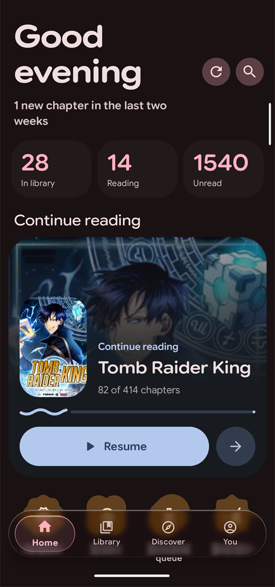
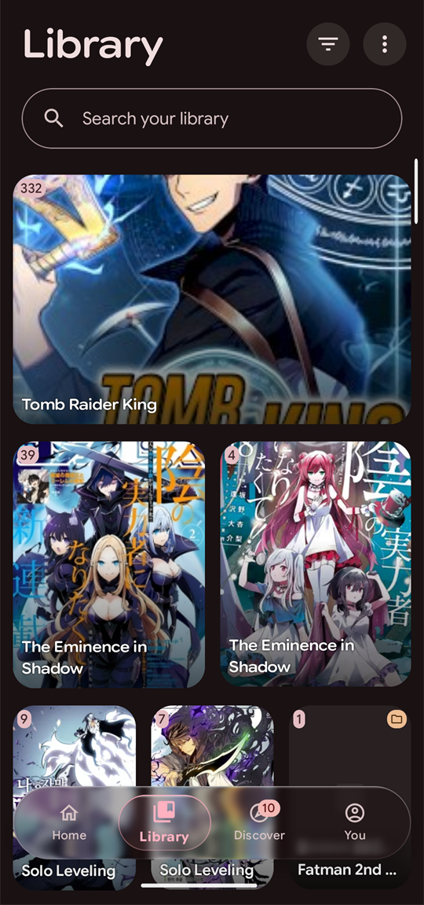
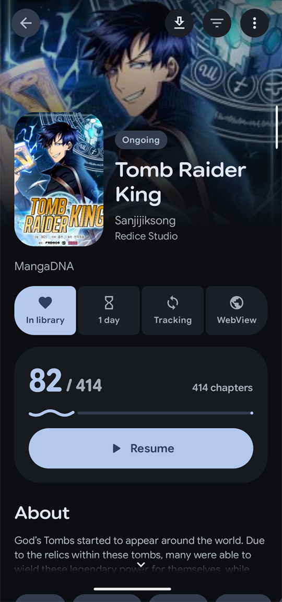
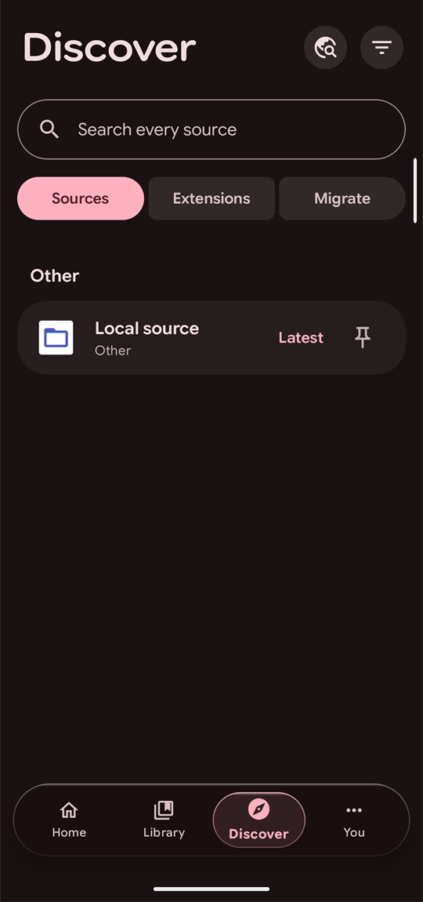
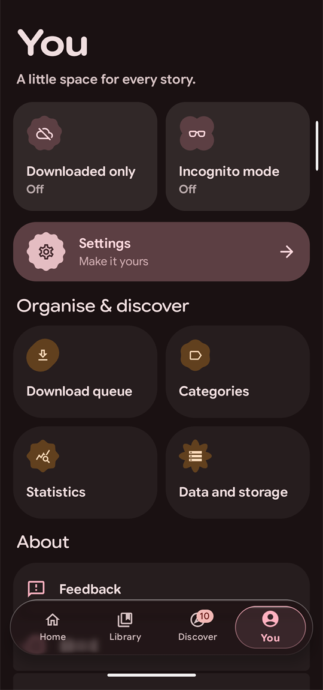
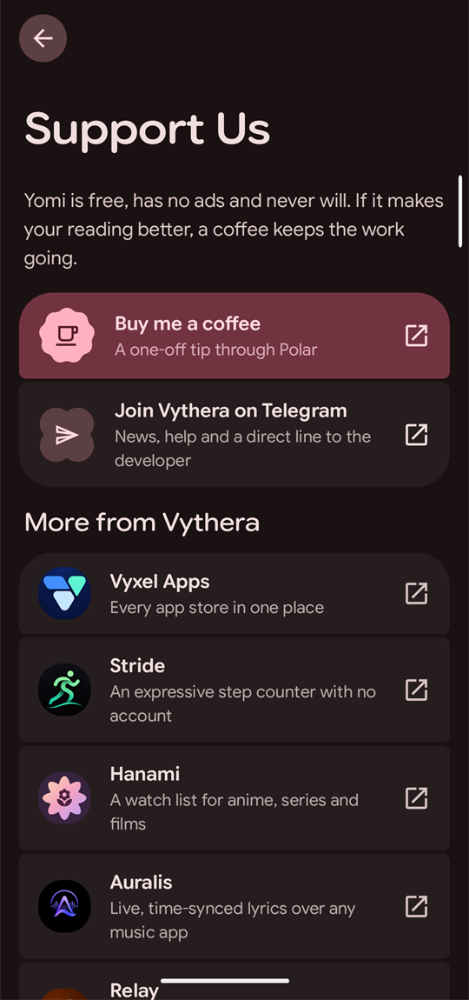

<div align="center">


# Yomi

**A manga, webtoon and comic reader for Android, redesigned in Material 3 Expressive.**

Version **0.2.1** · `com.manga.yomi` · Android 8.0+

[Download](https://github.com/NikhilKain/yomi/releases/latest) ·
[Telegram](https://t.me/vythera_apps) ·
[Report a bug](https://vythera-feedback.narzo9990.workers.dev/?app=yomi&type=bug&source=github) ·
[Buy me a coffee](https://polar.sh/checkout/polar_c_f0b0Tx0FTsUflgvnJTs09hmm6Va1x5ghbnwY34AIE8L)

<table>
  <tr>
    <td></td>
    <td></td>
    <td></td>
  </tr>
  <tr>
    <td align="center">Home</td>
    <td align="center">Library, bento grid</td>
    <td align="center">Series</td>
  </tr>
  <tr>
    <td></td>
    <td></td>
    <td></td>
  </tr>
  <tr>
    <td align="center">Discover</td>
    <td align="center">You</td>
    <td align="center">Support</td>
  </tr>
</table>

</div>

Yomi is a fork of [Mihon](https://github.com/mihonapp/mihon) with a new interface and a few
features of its own. Every Mihon feature is still here: extensions and sources, the library with
categories, filters and sorting, updates, history, downloads, tracking, backups, migration and the
full reader.

## What's different

- **Four places instead of five.** *Home* answers "what do I read now?": a continue-reading deck,
  new chapters, recently read and titles you haven't started. *Library*, *Discover* (sources,
  extensions, migration and a search across every source) and *You* (reading modes, tools and
  settings) cover the rest. Updates and History open from Home.
- **Bento grid.** Library and source results can mix tile sizes, one wide feature, two halves and
  three thirds. Comfortable grid, compact grid, cover-only grid and list are still one tap away.
- **Material 3 Expressive throughout.** Shaped icons, connected button groups, spring motion, wavy
  progress and large type, following the colour theme you pick.
- **Google Drive sync.** Sign in with Google once and your library, progress, categories, history
  and tracking stay the same on every device. Yomi can only see its own sync file in your Drive;
  there is no Yomi server. See [SYNC_SETUP.md](SYNC_SETUP.md).
- **Animated page turns, book spreads and PDF chapters** in the reader.
- **Crash reports stay with you.** If Yomi crashes it saves a report in the `logs` folder of your
  storage location, so you can attach it to a bug report. Nothing is sent anywhere by itself.
- **Feedback from inside the app.** Report a bug, request a feature or send a message from Settings,
  About or You.
- **Update checks.** Yomi looks for a new release on GitHub every day, week or month, or on a
  custom schedule (*About → Check automatically*), and can download and install it for you.

## Privacy

No ads, no accounts and no third-party analytics. Yomi sends an anonymous check-in (a hashed
device ID, device model, Android and app version, and how long the app is open) so Vythera can
count how many devices use it. It never includes your library, history, sources, searches or
accounts. Details are in [PRIVACY.md](PRIVACY.md).

## Download

Get the APK from [Releases](https://github.com/NikhilKain/yomi/releases/latest). Use
`yomi-<version>-arm64-v8a.apk` on most phones, or the universal APK if you are unsure.

Yomi installs next to Mihon and does not touch its data. To move your library over, create a
backup in Mihon (*More → Backup and restore*) and restore it in Yomi (*You → Data and storage*).

## Building

```bash
./gradlew :app:assembleRelease
```

Release signing reads `YOMI_STORE_FILE`, `YOMI_STORE_PASSWORD`, `YOMI_KEY_ALIAS` and
`YOMI_KEY_PASSWORD`. The built-in Google sign-in reads `YOMI_GDRIVE_CLIENT_ID` and
`YOMI_GDRIVE_CLIENT_SECRET`; without them, sync still works with your own Google Cloud client.
Notes on the fork are in [docs/YOMI.md](docs/YOMI.md).

## Credits

Yomi is made by [Vythera](https://t.me/vythera_apps), with ❤️ for the community. It is built on
[Mihon](https://github.com/mihonapp/mihon) and [Tachiyomi](https://github.com/tachiyomiorg), and
would not exist without their contributors. Yomi is independent and not affiliated with Mihon.
See [NOTICE](NOTICE) for attributions.

More from Vythera: [Vyxel Apps](https://github.com/NikhilKain/vyxel-apps) ·
[Stride](https://play.google.com/store/apps/details?id=com.vythera.stride) ·
[Hanami](https://github.com/NikhilKain/hanami-app) ·
[Auralis](https://play.google.com/store/apps/details?id=com.vythera.auralis) ·
[Relay](https://play.google.com/store/apps/details?id=com.vythera.relay)

## Disclaimer

The developers of this application have no affiliation with any content providers, and this
application hosts no content.

## License

<pre>
Copyright © 2015 Javier Tomás
Copyright © 2024 Mihon Open Source Project
Copyright © 2026 Vythera

Licensed under the Apache License, Version 2.0 (the "License");
you may not use this file except in compliance with the License.
You may obtain a copy of the License at

http://www.apache.org/licenses/LICENSE-2.0

Unless required by applicable law or agreed to in writing, software
distributed under the License is distributed on an "AS IS" BASIS,
WITHOUT WARRANTIES OR CONDITIONS OF ANY KIND, either express or implied.
See the License for the specific language governing permissions and
limitations under the License.
</pre>
